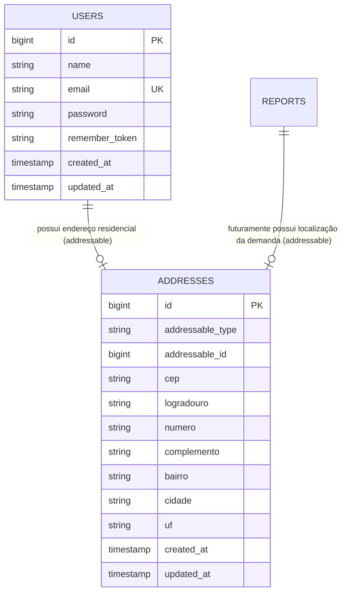
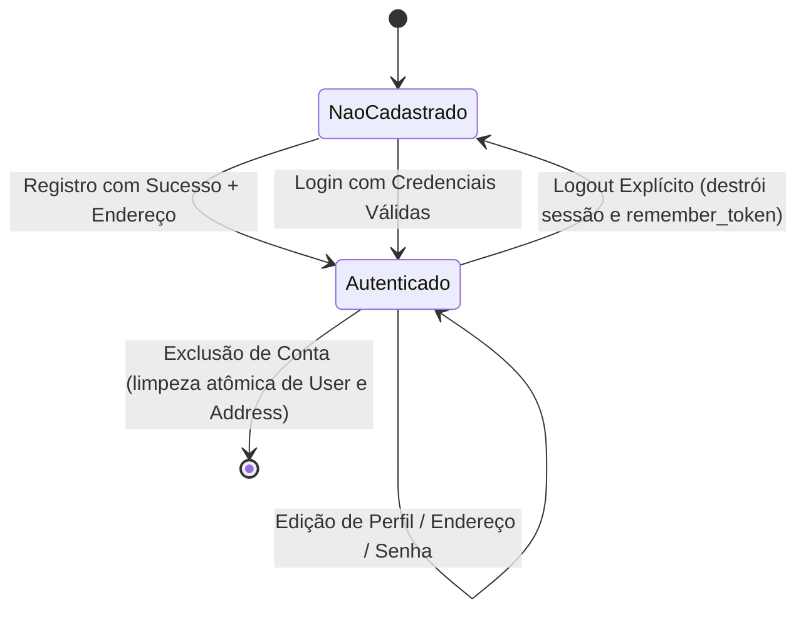

# Phase 1 Data Model: Fluxo de Autenticação e Gestão Cadastral do Cidadão (user-auth-profile)

## 1. Visão Geral das Entidades

O modelo de dados implementa a segregação estrita entre a identidade do cidadão (`User`) e as informações de localização física (`Address`) através de uma relação polimórfica (`MorphOne` / `MorphTo`).

---

## 2. Dicionário de Dados

### 2.1 Tabela `users`

Representa a credencial e a conta de acesso do munícipe no sistema Voz do Bairro.

| Campo | Tipo | Nulo | Padrão | Descrição |
|---|---|:---:|:---:|---|
| `id` | `BIGINT UNSIGNED` | Não | Auto-incremento | Identificador primário da conta |
| `name` | `VARCHAR(255)` | Não | - | Nome completo do munícipe |
| `email` | `VARCHAR(255)` | Não | - | Endereço de e-mail único para login e notificações |
| `password` | `VARCHAR(255)` | Não | - | Hash criptográfico seguro da senha (Bcrypt/Argon2id) |
| `remember_token` | `VARCHAR(100)` | Sim | `NULL` | Token de 60 caracteres para persistência de login (*Remember Me*) |
| `created_at` | `TIMESTAMP` | Sim | `CURRENT_TIMESTAMP` | Data/hora de registro na plataforma |
| `updated_at` | `TIMESTAMP` | Sim | `CURRENT_TIMESTAMP` | Data/hora da última alteração de perfil |

**Índices e Restrições**:
- `PRIMARY KEY (id)`
- `UNIQUE KEY users_email_unique (email)`

---

### 2.2 Tabela `addresses` (Polimórfica)

Representa localizações geográficas padronizadas, projetada para atender munícipes no presente e reportes de zeladoria no futuro.

| Campo | Tipo | Nulo | Padrão | Descrição |
|---|---|:---:|:---:|---|
| `id` | `BIGINT UNSIGNED` | Não | Auto-incremento | Identificador primário do endereço |
| `addressable_type` | `VARCHAR(255)` | Não | - | Nome da classe/modelo vinculado (ex.: `App\Models\User`) |
| `addressable_id` | `BIGINT UNSIGNED` | Não | - | Chave primária da entidade proprietária |
| `cep` | `VARCHAR(8)` | Não | - | Código de Endereçamento Postal sanitizado (apenas 8 dígitos) |
| `logradouro` | `VARCHAR(255)` | Não | - | Rua, avenida, travessa, praça |
| `numero` | `VARCHAR(20)` | Não | - | Número do imóvel ou "S/N" |
| `complemento` | `VARCHAR(100)` | Sim | `NULL` | Apto, bloco, casa fundos, referência |
| `bairro` | `VARCHAR(100)` | Não | - | Bairro validado via OpenCEP ou informado no fallback |
| `cidade` | `VARCHAR(100)` | Não | - | Município (ex.: Pouso Alegre) |
| `uf` | `VARCHAR(2)` | Não | - | Sigla da Unidade Federativa (ex.: MG) |
| `created_at` | `TIMESTAMP` | Sim | `CURRENT_TIMESTAMP` | Data/hora de criação do endereço |
| `updated_at` | `TIMESTAMP` | Sim | `CURRENT_TIMESTAMP` | Data/hora da última atualização do endereço |

**Índices e Restrições**:
- `PRIMARY KEY (id)`
- `INDEX addresses_addressable_type_addressable_id_index (addressable_type, addressable_id)`
- `INDEX addresses_bairro_cidade_index (bairro, cidade)` *(otimização para agregação e quórum)*

---

## 3. Regras de Validação de Negócio

### 3.1 Registro de Munícipe (`RegisterUserRequest`)
- `name`: obrigatório, string, mínimo 3, máximo 255 caracteres.
- `email`: obrigatório, e-mail válido com formato RFC, único na tabela `users`.
- `password`: obrigatório, confirmação obrigatória (`password_confirmation`), mínimo 8 caracteres, contendo ao menos uma letra maiúscula, uma minúscula, um número e um caractere especial (`Password::min(8)->letters()->mixedCase()->numbers()->symbols()`).
- `cep`: obrigatório, 8 dígitos numéricos válidos.
- `logradouro`: obrigatório, string, máximo 255.
- `numero`: obrigatório, string, máximo 20.
- `complemento`: opcional, string, máximo 100.
- `bairro`: obrigatório, string, máximo 100.
- `cidade`: obrigatório, string, máximo 100.
- `uf`: obrigatório, string, exatos 2 caracteres maiúsculos.

### 3.2 Autenticação (`LoginUserRequest`)
- `email`: obrigatório, formato e-mail.
- `password`: obrigatório, string.
- `remember`: opcional, booleano (default: false).

### 3.3 Edição de Perfil (`UpdateProfileRequest`)
- `name`: obrigatório, string, máx 255.
- `email`: obrigatório, e-mail válido, único em `users` exceto o ID atual.
- `current_password`: obrigatório SE o campo `email` tiver sido alterado em relação ao original.
- Campos de endereço (`cep`, `logradouro`, `numero`, `complemento`, `bairro`, `cidade`, `uf`): validados conforme as regras de registro.

### 3.4 Alteração de Senha (`UpdatePasswordRequest`)
- `current_password`: obrigatório, validado contra a senha atual (`current_password` rule do Laravel).
- `password`: obrigatório, confirmado (`password_confirmation`), política de alta complexidade (mínimo 8 caracteres, maiúscula, minúscula, número, caractere especial).

### 3.5 Exclusão de Conta (`DeleteAccountRequest`)
- `current_password`: obrigatório, validado contra a senha atual do usuário autenticado.

---

## 4. Ciclo de Vida e Transições de Estado

