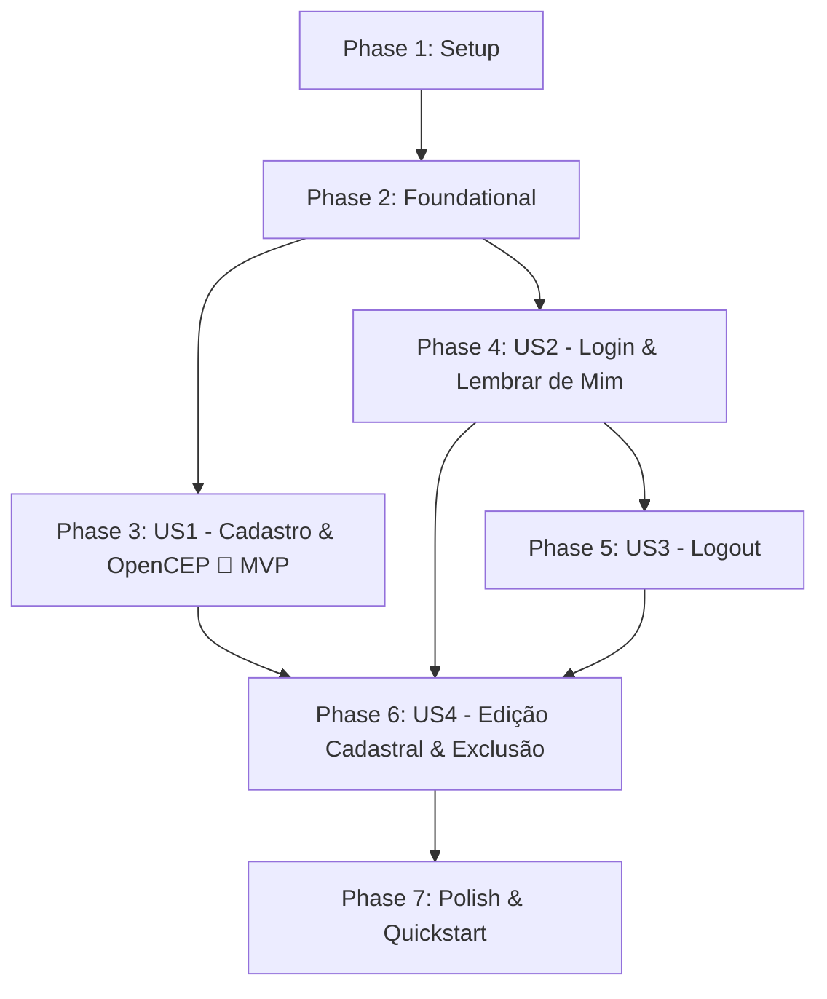

# Tasks: Fluxo de Autenticação e Gestão Cadastral do Cidadão (user-auth-profile)

**Input**: Design documents from `/specs/003-user-auth-profile/` (`spec.md`, `plan.md`, `research.md`, `data-model.md`, `contracts/auth-profile-api.yaml`, `quickstart.md`)  
**Prerequisites**: `plan.md`, `spec.md`, `data-model.md`, `contracts/auth-profile-api.yaml`

---

## Phase 1: Setup (Shared Infrastructure)

**Purpose**: Inicialização da infraestrutura do backend Laravel 11 e conectividade com a API.

- [x] T001 Criar a estrutura base de diretórios do Laravel em `app/Http/Controllers`, `app/Http/Requests`, `app/Models`, `app/Services` e `database/migrations`
- [x] T002 [P] Configurar roteamento de API e middlewares stateful em `bootstrap/app.php` e criar `routes/api.php`
- [x] T003 [P] Configurar variáveis de ambiente e conexão com banco de dados em `.env` e `.env.example`
- [x] T004 [P] Implementar cliente HTTP com suporte a CSRF e credenciais seguras em `resources/js/lib/api.ts`

---

## Phase 2: Foundational (Blocking Prerequisites)

**Purpose**: Estrutura essencial de banco de dados, modelos polimórficos e serviço OpenCEP que bloqueia todas as histórias de usuário.

**⚠️ CRITICAL**: Nenhuma história de usuário pode ser iniciada antes da conclusão desta fase.

- [x] T005 Criar migration da tabela de usuários em `database/migrations/2026_11_03_000001_create_users_table.php` com campos `id` (BIGINT UNSIGNED), `name` (VARCHAR 255), `email` (VARCHAR 255 UNIQUE), `password` (VARCHAR 255), `remember_token` (VARCHAR 100 NULLABLE) e `timestamps`
- [x] T006 Criar migration da tabela polimórfica de endereços em `database/migrations/2026_11_03_000002_create_addresses_table.php` com campos `id` (BIGINT UNSIGNED), `addressable_type` (VARCHAR 255), `addressable_id` (BIGINT UNSIGNED), `cep` (VARCHAR 8), `logradouro` (VARCHAR 255), `numero` (VARCHAR 20), `complemento` (VARCHAR 100 NULLABLE), `bairro` (VARCHAR 100), `cidade` (VARCHAR 100), `uf` (VARCHAR 2), índice composto `(addressable_type, addressable_id)` e índice `(bairro, cidade)`
- [x] T007 [P] Criar migration da tabela de sessões em `database/migrations/2026_11_03_000003_create_sessions_table.php`
- [x] T008 [P] Criar modelo Eloquent `Address` com relacionamento polimórfico `addressable(): MorphTo` em `app/Models/Address.php`
- [x] T009 [P] Criar modelo Eloquent `User` com autenticação e relacionamento polimórfico `address(): MorphOne` em `app/Models/User.php`
- [x] T010 Implementar serviço de consulta OpenCEP com timeout de 3s, normalização de CEP e detecção da região piloto (Pouso Alegre / MG) em `app/Services/CepService.php`
- [x] T011 Implementar controller e rota de consulta de CEP em `app/Http/Controllers/CepController.php` e `routes/api.php`

**Checkpoint**: Fundação pronta (migrations, models, serviço de CEP) — a implementação das histórias de usuário pode prosseguir.

---

## Phase 3: User Story 1 - Cadastro de Novo Munícipe com Endereço Validado via CEP (Priority: P1) 🎯 MVP

**Goal**: Permitir que qualquer cidadão se cadastre na plataforma informando seus dados pessoais e seu endereço validado via OpenCEP (com preenchimento automático, botão de recarga manual, fallback e alerta de localidade fora do piloto), persistindo o munícipe e o endereço polimórfico.

**Independent Test**: Preencher o formulário de cadastro com um CEP válido da API OpenCEP (ex: 37550-000), completar número e senha de alta complexidade, submeter e verificar que a conta foi criada, o endereço foi vinculado polimorficamente na tabela `addresses` e o usuário foi logado.

### Implementation for User Story 1

- [x] T012 [P] [US1] Criar Form Request de validação de cadastro `RegisterUserRequest` em `app/Http/Requests/RegisterUserRequest.php` com regras: `name` (required, min 3, max 255), `email` (required, email, unique:users), `password` (required, confirmed, Password::min(8)->letters()->mixedCase()->numbers()->symbols()), `cep` (required, 8 dígitos), `logradouro` (required, max 255), `numero` (required, max 20), `complemento` (nullable, max 100), `bairro` (required, max 100), `cidade` (required, max 100), `uf` (required, size 2)
- [x] T013 [US1] Implementar método de registro `register` em `app/Http/Controllers/AuthController.php` criando atomicamente `User` e `Address` via `DB::transaction`, realizando login imediato e registrando endpoint `POST /api/auth/register` em `routes/api.php`
- [x] T014 [US1] Integrar busca de CEP no componente `resources/js/components/presentation/AuthDialog.vue` com acionamento automático ao completar 8 dígitos, botão dedicado de busca/recarga, indicador visual de carregamento, aviso amigável de região fora do piloto e destravamento para digitação manual em caso de erro
- [x] T015 [US1] Conectar formulário de cadastro de `AuthDialog.vue` ao endpoint de registro e atualizar ação de cadastro em `resources/js/stores/sessionStore.ts`
- [x] T016 [US1] Criar teste automatizado de Feature em `tests/Feature/RegistrationTest.php` cobrindo sucesso no cadastro, vínculo do endereço polimórfico, rejeição de e-mail duplicado, rejeição de senha fraca e fallback de CEP

**Checkpoint**: User Story 1 (MVP) completamente funcional e testável de forma independente.

---

## Phase 4: User Story 2 - Autenticação com Persistência de Sessão ("Lembrar de Mim") (Priority: P1)

**Goal**: Permitir que munícipes façam login com e-mail e senha, marcando a opção "Lembrar de mim" para manter a sessão ativa em acessos futuros no mesmo navegador, com proteção contra força bruta.

**Independent Test**: Realizar login informando credenciais válidas com a opção "Lembrar de mim" marcada, fechar a janela do navegador, reabrir a aplicação e constatar que a sessão continua ativa e autenticada.

### Implementation for User Story 2

- [x] T017 [P] [US2] Criar Form Request `LoginUserRequest` em `app/Http/Requests/LoginUserRequest.php` com regras: `email` (required, email), `password` (required, string), `remember` (boolean)
- [x] T018 [US2] Implementar método `login` com `Auth::attempt($credentials, $remember)` e throttle em `app/Http/Controllers/AuthController.php`, registrando rota `POST /api/auth/login` em `routes/api.php`
- [x] T019 [P] [US2] Implementar método `me` em `app/Http/Controllers/AuthController.php` retornando dados do usuário e endereço vinculado via rota `GET /api/auth/me` em `routes/api.php`
- [x] T020 [US2] Adicionar checkbox acessível "Lembrar de mim" na aba de login em `resources/js/components/presentation/AuthDialog.vue`
- [x] T021 [US2] Atualizar ações `login` e inicialização de sessão em `resources/js/stores/sessionStore.ts` consumindo a API real com persistência de cookie
- [x] T022 [US2] Criar teste automatizado de Feature em `tests/Feature/LoginTest.php` validando autenticação bem-sucedida, geração de cookie/remember_token, credenciais inválidas e bloqueio por rate limiting

**Checkpoint**: User Stories 1 e 2 funcionais e integradas.

---

## Phase 5: User Story 3 - Encerramento Seguro de Sessão (Logout) (Priority: P2)

**Goal**: Permitir que o munícipe autenticado encerre sua sessão a qualquer momento, invalidando a sessão no servidor e revogando os cookies de persistência.

**Independent Test**: Clicar em "Sair" na interface logada, verificar o encerramento da sessão e constatar que rotas protegidas não podem mais ser acessadas sem nova autenticação.

### Implementation for User Story 3

- [x] T023 [US3] Implementar método `logout` em `app/Http/Controllers/AuthController.php` invalidando a sessão (`request->session()->invalidate()`, regeneração de CSRF e limpeza do `remember_token`), registrando rota `POST /api/auth/logout` em `routes/api.php`
- [x] T024 [US3] Atualizar componente `resources/js/components/presentation/Navbar.vue` para disparar a ação de logout real via API e resetar o estado reativo
- [x] T025 [US3] Atualizar ação `logout` em `resources/js/stores/sessionStore.ts` limpando o usuário atual e o estado de autenticação
- [x] T026 [US3] Criar teste automatizado de Feature em `tests/Feature/LogoutTest.php` validando a invalidação da sessão e desautenticação imediata

**Checkpoint**: Encerramento seguro de sessão totalmente funcional.

---

## Phase 6: User Story 4 - Visualização e Edição de Dados Cadastrais, Senha e Exclusão de Conta (Priority: P2)

**Goal**: Permitir que o munícipe visualize seus dados cadastrais, altere nome/endereço com revalidação de CEP, atualize e-mail (com confirmação por senha atual), troque sua senha (com política de alta complexidade) e exclua definitivamente sua conta e endereço associado.

**Independent Test**: Acessar o diálogo de perfil, atualizar endereço via CEP, alterar e-mail informando a senha atual, alterar a senha de acesso, e por fim acionar a exclusão definitiva confirmando com a senha, verificando a remoção física no banco.

### Implementation for User Story 4

- [x] T027 [P] [US4] Criar Form Request `UpdateProfileRequest` em `app/Http/Requests/UpdateProfileRequest.php` com regras: `name` (required, max 255), `email` (required, email, unique:users,email,{id}), `current_password` (required_if email alterado), campos de endereço (`cep`, `logradouro`, `numero`, `complemento`, `bairro`, `cidade`, `uf`)
- [x] T028 [P] [US4] Criar Form Request `UpdatePasswordRequest` em `app/Http/Requests/UpdatePasswordRequest.php` com regras: `current_password` (required, current_password), `password` (required, confirmed, Password::min(8)->letters()->mixedCase()->numbers()->symbols())
- [x] T029 [P] [US4] Criar Form Request `DeleteAccountRequest` em `app/Http/Requests/DeleteAccountRequest.php` com regra: `current_password` (required, current_password)
- [x] T030 [US4] Implementar `ProfileController` com métodos `updateProfile`, `updatePassword` e `deleteAccount` (com exclusão em cascata do `Address` e encerramento de sessão) em `app/Http/Controllers/ProfileController.php` e registrar rotas em `routes/api.php`
- [x] T031 [US4] Criar componente de diálogo de perfil `resources/js/components/presentation/ProfileDialog.vue` com abas para Dados Pessoais & Endereço (com busca OpenCEP e campo de senha condicional para troca de e-mail), Alteração de Senha e Zona de Perigo / Exclusão de Conta
- [x] T032 [US4] Integrar `ProfileDialog.vue` no cabeçalho `resources/js/components/presentation/Navbar.vue`, permitindo abrir o perfil ao clicar no avatar ou nome do munícipe logado
- [x] T033 [US4] Adicionar métodos de atualização de perfil, troca de senha e exclusão de conta em `resources/js/stores/sessionStore.ts`
- [x] T034 [US4] Criar teste automatizado de Feature em `tests/Feature/ProfileTest.php` cobrindo atualização de dados, bloqueio de troca de e-mail sem senha atual, alteração de senha e exclusão definitiva da conta com remoção do endereço polimórfico

**Checkpoint**: Ciclo completo de gestão cadastral, segurança e exclusão finalizado.

---

## Phase 7: Polish & Cross-Cutting Concerns

**Purpose**: Hidratação de sessão inicial, tratamento de erros globais e validação ponta a ponta.

- [x] T035 [P] Implementar hidratação automática da sessão no carregamento da aplicação em `resources/js/App.vue` chamando `fetchUser` para recuperar o munícipe logado via cookie *Remember Me*
- [x] T036 Executar validação manual de todos os cenários do guia `specs/003-user-auth-profile/quickstart.md`
- [x] T037 Executar suíte completa de testes automatizados via `php artisan test` e build de produção `npm run build`

---

## Dependencies & Execution Order

### Phase Dependencies

- **Setup (Phase 1)**: Sem dependências externas — inicia imediatamente.
- **Foundational (Phase 2)**: Depende da conclusão do Setup. **BLOQUEIA** todas as histórias de usuário.
- **User Story 1 (Phase 3)**: Depende da Fundação (migrations, models e CepService).
- **User Story 2 (Phase 4)**: Depende da Fundação.
- **User Story 3 (Phase 5)**: Depende de US2 (login funcional para validar encerramento).
- **User Story 4 (Phase 6)**: Depende de US1 e US2 (requer munícipe cadastrado e logado para editar/excluir).
- **Polish (Phase 7)**: Depende de todas as histórias implementadas.

---

## Parallel Opportunities

- **Phase 1**: T002, T003 e T004 podem ser executadas em paralelo.
- **Phase 2**: T007, T008 e T009 podem ser criadas em paralelo após as migrations base.
- **Phase 6**: Os Form Requests T027, T028 e T029 podem ser desenvolvidos em paralelo.
- **User Stories 1 e 2**: Após a Fase 2, as tarefas de backend de US1 e US2 podem ser desenvolvidas em paralelo por desenvolvedores distintos.

---

## Implementation Strategy

### MVP First (User Story 1 Only)
1. Concluir Phase 1 (Setup)
2. Concluir Phase 2 (Foundational: migrations de `users` e `addresses`, models polimórficos, serviço OpenCEP)
3. Concluir Phase 3 (US1: Cadastro de munícipe com CEP validado e sessão iniciada)
4. **Validar MVP**: Cadastrar um novo morador e confirmar persistência do endereço polimórfico.

### Incremental Delivery
1. Foundation pronta → Entrega da estrutura de dados polimórfica.
2. US1 → Entrega de Cadastro com OpenCEP (MVP!).
3. US2 → Entrega de Login com "Lembrar de mim" e proteção de força bruta.
4. US3 → Entrega de Logout seguro.
5. US4 → Entrega de Edição de Perfil, Senha e Exclusão Definitiva de Conta.
